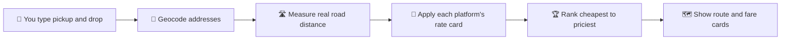

[README.md](https://github.com/user-attachments/files/34543269/README.md)
<div align="center">

# 🛺 FareCompare

### Stop guessing. Start saving on every ride in Bengaluru.

Compare **auto 🛺, bike 🛵 and cab 🚗** fares across **Namma Yatri, Rapido and Ola** in one tap, and see your route on a live map 🗺️


</div>

---

## ✨ Why FareCompare?

Three ride apps. Three different prices. One short trip.
Instead of opening every app and comparing by hand, **type your pickup and drop once** and let FareCompare rank every option from cheapest to priciest.

| | Feature | What you get |
| --- | --- | --- |
| 🔎 | **Smart address search** | Suggestions appear as you type, limited to Bengaluru so results stay accurate |
| 🗺️ | **Live route map** | Your real driving route drawn between pickup and drop on a dark map |
| 💸 | **Cheapest-first ranking** | A glowing **Cheapest** badge and a "You could save ₹X" stat |
| 📊 | **Visual fare bars** | See at a glance how much more each ride costs |
| 🔄 | **One-tap swap** | Flip pickup and drop instantly for the return trip |
| 📱 | **Mobile friendly** | Works in any phone browser, nothing to install |
| 🌙 | **Dark theme** | Easy on the eyes, day or night |

---

## 🚦 Rides compared

| Ride | Platform | Vibe |
| --- | --- | --- |
| 🛺 Auto | **Namma Yatri** | Zero-commission, driver-friendly |
| 🛺 Auto | **Rapido** | Quick and everywhere |
| 🛵 Bike | **Rapido** | Cheapest way through traffic |
| 🚗 Cab (Mini) | **Ola** | AC comfort for longer trips |

---

## 🧠 How it works



1. **Frontend** collects your two locations and shows suggestions as you type.
2. **Backend** resolves them to coordinates, asks a routing service for the real driving distance and time, then runs each platform's fare formula.
3. **Frontend** draws the route and renders the ranked fare cards.

**Fare formula:** `fare = max(minFare, base + (distanceKm − baseKm) × perKm)`

---

## 🧰 Tech stack

| Layer | Tools |
| --- | --- |
| 🎨 Frontend | HTML, CSS, vanilla JavaScript, [Leaflet](https://leafletjs.com) |
| ⚙️ Backend | Node.js, Express |
| 📍 Geocoding | [Photon](https://photon.komoot.io) (OpenStreetMap data) |
| 🛣️ Routing | [OSRM](https://project-osrm.org) public server |

---

## 📁 Project structure

```
farecompare/
├── 🎨 frontend/
│   ├── index.html     # the website
│   ├── style.css      # dark theme styling
│   ├── app.js         # search, map and results logic
│   └── config.js      # set API_BASE if the backend is hosted elsewhere
├── ⚙️ backend/
│   ├── server.js      # /api/geocode and /api/compare
│   ├── fare.js        # editable rate cards
│   └── package.json
├── README.md
└── .gitignore
```

---

## 🚀 Quick start

You need [Node.js 18+](https://nodejs.org).

```bash
# 1. Clone the project
git clone https://github.com/<your-username>/farecompare.git
cd farecompare/backend

# 2. Install dependencies
npm install

# 3. Start the server
npm start
```

Open **http://localhost:3000** 🎉 (the backend serves the frontend too).

---

## 🔌 API reference

| Method | Endpoint | Description |
| --- | --- | --- |
| `GET` | `/api/geocode?q=koramangala` | Address suggestions inside Bengaluru |
| `POST` | `/api/compare` | Distance, time, route and ranked fares |
| `GET` | `/api/health` | Quick check that the server is alive |

<details>
<summary><b>📨 Example request and response</b></summary>

```http
POST /api/compare
Content-Type: application/json

{
  "pickup": { "lat": 12.9352, "lng": 77.6245 },
  "drop":   { "lat": 13.0475, "lng": 77.6198 }
}
```

```json
{
  "distanceKm": 14.8,
  "durationMin": 38,
  "distanceSource": "road",
  "fares": [
    { "platform": "Rapido", "vehicle": "Bike", "fare": 135 },
    { "platform": "Namma Yatri", "vehicle": "Auto", "fare": 222 }
  ],
  "cheapest": "rapido_bike"
}
```

(The real response also includes the route geometry and every ride.)

</details>

---

## 🌍 Deploy it free

**One-click style on [Render](https://render.com):**

| Setting | Value |
| --- | --- |
| Root Directory | `backend` |
| Build Command | `npm install` |
| Start Command | `npm start` |
| Plan | Free |

You get a public link that works on any phone. 📱
Hosting the frontend separately (Netlify, GitHub Pages)? Set `window.API_BASE` in `frontend/config.js` to your backend URL.

> 💤 On the free plan the server sleeps when idle, so the first visit after a quiet spell can take about a minute.

---

## ⚠️ Honest note about the prices

FareCompare shows **estimates**, not live quotes.
Rapido, Ola and Namma Yatri do not offer public live-fare APIs, so fares are calculated from approximate public rate cards. Surge pricing, tolls and waiting charges are **not** included, so the price inside each app can differ.

You can tune the numbers any time in [`backend/fare.js`](backend/fare.js).

---

## 🗺️ Roadmap

- [ ] 🔴 Live Namma Yatri fares through the ONDC network
- [ ] 📍 Use my current location for pickup
- [ ] 🔗 Deep links that open the chosen app with the trip pre-filled
- [ ] ⏰ Peak-hour and night-time fare adjustments
- [ ] 🕘 Recent trips and favourite places
- [ ] 🌆 More cities beyond Bengaluru

---

## 🙌 Credits

- Map data © [OpenStreetMap](https://www.openstreetmap.org/copyright) contributors
- Geocoding by [Photon](https://photon.komoot.io), routing by [OSRM](https://project-osrm.org)
- Maps rendered with [Leaflet](https://leafletjs.com)

---

<div align="center">

Built with ❤️ in Bengaluru by **&lt;Your Name&gt;**

⭐ If this saved you a few rupees, star the repo!

</div>
